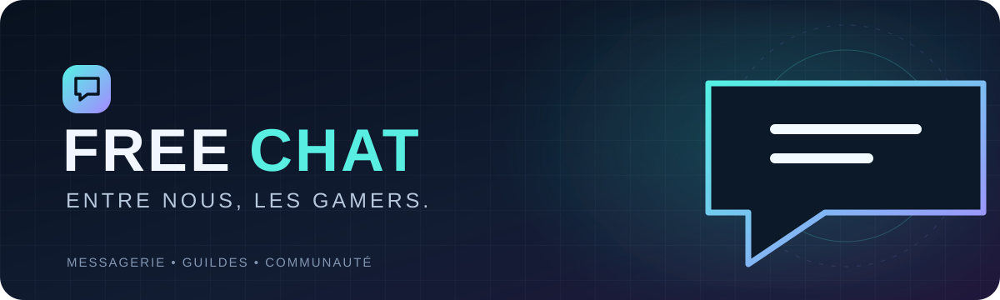

<div align="center">
  
  <h1>FREE CHAT</h1>
  <p><strong>Entre nous, les gamers.</strong></p>
  <p>Une messagerie communautaire pensée pour les joueurs, sur mobile et ordinateur.</p>
  <p>
    
    
    
  </p>
</div>

---

## ✦ L'idée

FREE CHAT veut offrir aux joueurs un endroit où discuter, retrouver leur escouade, créer des guildes et faire vivre leur communauté. L'expérience est conçue pour être rapide, lisible et agréable sur téléphone comme sur ordinateur.

### Ce qui prend forme

| Espace | Objectif | État |
| --- | --- | --- |
| **Messages** | Discussions et échanges entre joueurs | Aperçu interactif |
| **Guildes** | Créer et organiser des communautés | Aperçu interactif |
| **Découvrir** | Publications et vie communautaire | Aperçu interactif |
| **Profil gamer** | Identité et progression | Aperçu interactif |
| **PWA** | Installation sur mobile et desktop | Base ajoutée |
| **Comptes & sécurité** | Authentification, règles d'accès et modération | À connecter |
| **Temps réel** | Messages et présence synchronisés | À construire |

> Les données visibles dans l'aperçu sont fictives et locales au navigateur. Elles ne sont pas encore enregistrées dans un compte ni synchronisées entre joueurs.

## 🎮 Direction artistique

- Interface sombre premium, avec une future variante claire.
- Cyan électrique, violet néon et accents dorés.
- Effets lumineux discrets, surfaces vitrées et animations sobres.
- Navigation pensée pour le tactile et les petits écrans.
- Vocabulaire gamer : guildes, escouades, joueurs et salons.

## 🧰 Technologies

- **React 18** + **Vite**
- **CSS** responsive
- **Supabase** prévu pour Auth, PostgreSQL, Realtime et Storage
- **Netlify** prévu pour l'hébergement
- **PWA** avec manifeste et cache de base

## 🚀 Lancer le projet

Prérequis : Node.js 20 ou version compatible et npm.

```bash
git clone https://github.com/ooopppmarcelle-glitch/free-chat.git
cd free-chat
npm install
cp .env.example .env
npm run dev
```

Ouvre ensuite l'adresse locale indiquée par Vite.

### Configuration Supabase

Le fichier `.env.example` présente les variables attendues :

```env
VITE_SUPABASE_URL=
VITE_SUPABASE_ANON_KEY=
```

Laisse-les vides pour consulter l'aperçu local. Pour connecter un projet Supabase, renseigne uniquement l'URL et la clé publique anon/publishable. **Ne place jamais une clé `service_role` dans le frontend ou dans GitHub.**

Les politiques RLS devront être définies et testées avant d'activer les données personnelles ou les échanges privés.

## 🛡️ Sécurité et transparence

- Les fonctions sont annoncées comme disponibles uniquement après implémentation et test.
- Les comptes, messages privés, notifications push et modération réelle ne sont pas encore activés dans cette première base.
- L'UID Free Fire ne constitue pas une preuve d'identité Garena.
- FREE CHAT est un projet indépendant, non affilié à Garena et non officiel.

## 🗺️ Feuille de route

1. Stabiliser l'interface et les parcours mobiles.
2. Connecter l'authentification et les profils avec Supabase.
3. Définir le schéma SQL et les politiques RLS.
4. Construire la messagerie persistante et temps réel.
5. Ajouter guildes, publications et modération.
6. Configurer notifications et déploiement public.
7. Tester sur plusieurs téléphones et navigateurs.

## 🤝 Contributions

Les retours sont les bienvenus : bugs d'affichage, problèmes d'accessibilité, idées de fonctionnalités et améliorations de traduction. Merci de décrire les étapes pour reproduire un problème.

## ✨ Crédit

**Farel — Free Chat Studio**

*Une communauté. Une escouade. Ton univers.*
